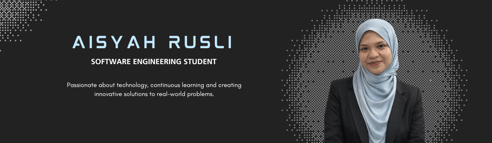

  

  Passionate about technology, continuous learning and creating innovative solutions to real-world problems.

  
  
  

### 📌 Currently

- 🎓 Pursuing a Bachelor's Degree in Software Engineering at UPSI.
- 🚗 Developing UPSI NexRide, a campus ride-sharing mobile application.
- 🌱 Exploring new technologies and improving my technical skills.
- 💼 Open to internship opportunities and professional growth.

